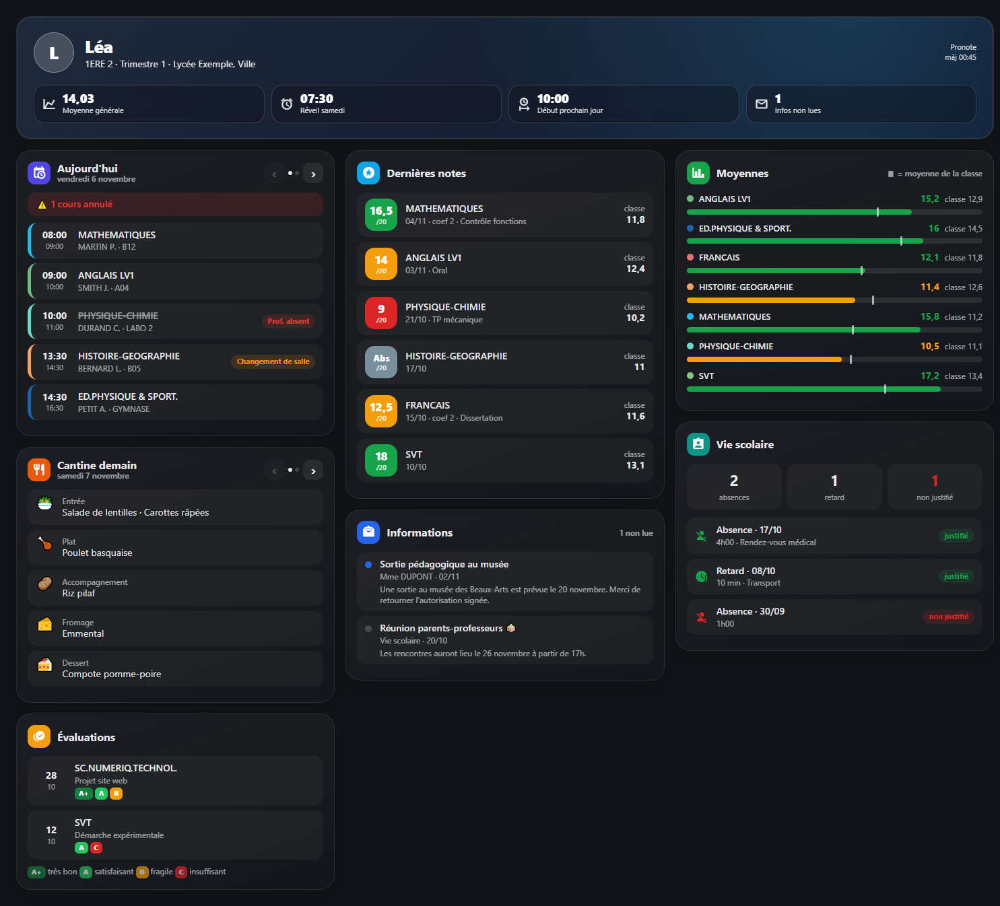

# Tableau de bord Pronote pour Home Assistant

Un tableau de bord complet pour suivre la scolarité de son enfant dans Home Assistant, avec les notifications qui vont avec.



*Aperçu avec des données fictives.*

## Ce qu'il affiche

- **Bandeau** : classe, période, moyenne générale, heure de réveil conseillée, début des cours du prochain jour, infos non lues.
- **Emploi du temps** : les prochains jours de cours, avec des flèches ‹ › pour passer d'un jour à l'autre. Les cours annulés sont barrés, les statuts (prof absent, changement de salle…) apparaissent en pastille et le cours en cours est mis en évidence. Une fois les cours du jour terminés, la carte s'ouvre sur le lendemain.
- **Cantine** : les menus à venir, un par page, avec les mêmes flèches.
- **Dernières notes** : note en couleur selon le résultat, moyenne de la classe, coefficient et commentaire.
- **Moyennes** : une barre par matière avec un repère pour la moyenne de la classe (vert au-dessus, orange en dessous).
- **Évaluations par compétences** : pastilles A+ / A / B / C.
- **Vie scolaire** : compteurs et liste des absences et retards, justifiés ou non.
- **Informations** de l'établissement, avec les non lues en évidence.

Et deux automations de notification :

- **Nouvelle note** : un message à chaque note publiée.
- **Changement d'emploi du temps** : prof absent, cours annulé, remplacement, changement de salle… pour aujourd'hui et le prochain jour de cours. Seuls les nouveaux changements sont envoyés, pas ceux déjà signalés.

Exemple de notification :

```
🚫 Prof absent - Léa
MATHEMATIQUES le 09/11 de 14:30 à 15:30 : Prof. absent
```

## Prérequis

- L'intégration **[Pronote](https://github.com/delphiki/hass-pronote)** de delphiki, installée et configurée (via HACS).
- La carte **[button-card](https://github.com/custom-cards/button-card)** (HACS > Frontend). Testé avec la version 7.0.1.
- Pour les notifications : une entité `notify` (bot Telegram, application mobile Home Assistant, etc.).

Le tableau de bord n'utilise aucune autre carte custom.

## Installation du tableau de bord

1. Copiez [dashboards/pronote.yaml](dashboards/pronote.yaml) dans le dossier `/config/dashboards/` de Home Assistant.

2. **Adaptez le fichier à votre enfant** :
   - Remplacez partout `sensor.pronote_nom_prenom_` par le préfixe de vos capteurs Pronote. Pour le trouver : Paramètres > Entités, cherchez `pronote`. Par exemple `sensor.pronote_dupont_lea_today_s_timetable` donne le préfixe `sensor.pronote_dupont_lea_`. Un « Rechercher / Remplacer tout » dans votre éditeur suffit.
   - En haut du fichier, dans `pronote_core > variables`, mettez le prénom (`prenom`) et l'établissement (`etablissement`).

3. Déclarez le tableau de bord dans `configuration.yaml` :

   ```yaml
   lovelace:
     dashboards:
       dashboard-pronote:
         mode: yaml
         title: Pronote
         icon: mdi:school
         show_in_sidebar: true
         filename: dashboards/pronote.yaml
   ```

4. Redémarrez Home Assistant. « Pronote » apparaît dans la barre latérale.

Le tableau de bord est en mode YAML : on le modifie dans le fichier, pas depuis l'interface. Après une modification, un simple rechargement de la page (Ctrl+F5) suffit.

## Installation des notifications

1. Ouvrez [automations/pronote_notifications.yaml](automations/pronote_notifications.yaml).
2. Remplacez :
   - `sensor.pronote_nom_prenom_` par le préfixe de vos capteurs,
   - `notify.mon_telegram` par votre entité de notification (par exemple `notify.mobile_app_mon_telephone`),
   - `Léa` par le prénom de votre enfant.
3. Collez les deux automations dans votre `automations.yaml` (ou créez chaque automation dans l'interface, puis passez en mode YAML et collez le contenu).
4. Rechargez les automations (Outils de développement > YAML > Automatisations).

**Tester la notification de note sans attendre une vraie note** : Outils de développement > Événements, type d'événement `pronote_event`, avec ces données :

```yaml
type: new_grade
child_nickname: Léa
data:
  subject: MATHEMATIQUES
  grade_out_of: 15/20
  comment: Test
  date: "2026-11-05"
```

Le bouton « Exécuter » d'une automation ne permet pas de tester celle des notes, car il ne fournit aucun événement.

## Réglages possibles

- **Heure de réveil** : la règle est dans la carte du bandeau. Par défaut, 6h30, ou 7h30 si le premier cours non annulé commence à 9h ou plus tard. Cherchez `'09:00'` dans le fichier pour l'adapter.
- **Nombre de jours d'emploi du temps** : `.slice(0, 7)` dans le modèle `pronote_edt`.
- **Nombre de notes affichées** : `notes.slice(0, 8)` dans la carte « Dernières notes ».
- **Disposition** : le tableau utilise une vue en sections. Chaque colonne est une section, et on déplace une carte en déplaçant son bloc dans le fichier.

## Notes techniques

Pour celles et ceux qui veulent adapter le code :

- Les cartes sont des `custom:button-card` dont tout le contenu est généré en HTML par un modèle JavaScript (`custom_fields.html`). La feuille de style commune est dans la variable `css` du modèle `pronote_core`.
- **N'utilisez pas `html` comme nom de variable** dans un modèle button-card : c'est déjà un paramètre de la fonction, et sa redéclaration provoque une erreur `ButtonCardJSTemplateError`.
- Les flèches ‹ › reposent sur des boutons radio cachés et du CSS (`:checked ~ .panel`). button-card annule l'action par défaut des clics sur la carte, donc chaque flèche coche elle-même son bouton radio via `onclick`. Il faut aussi `pointer-events: auto` sur la carte, sinon une carte sans `tap_action` ne reçoit aucun clic.
- `triggers_update` liste uniquement les capteurs Pronote. Une mise à jour d'une autre entité ne réaffiche donc pas la carte et ne la renvoie pas sur aujourd'hui pendant la navigation.

## Crédits

- Données : intégration [hass-pronote](https://github.com/delphiki/hass-pronote) de delphiki.
- Cartes : [button-card](https://github.com/custom-cards/button-card).
- Inspiré par le travail de [Sigalou Domotique](https://www.sigalou-domotique.fr/travail-sur-les-cartes-ha-de-pronote) sur les cartes Pronote.

## Licence

MIT, voir [LICENSE](LICENSE).
